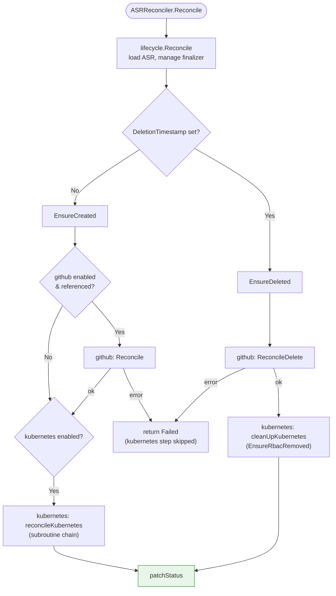
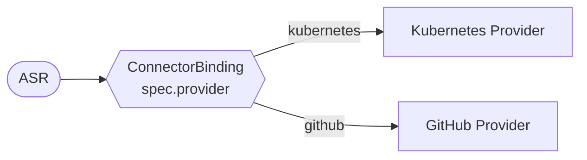
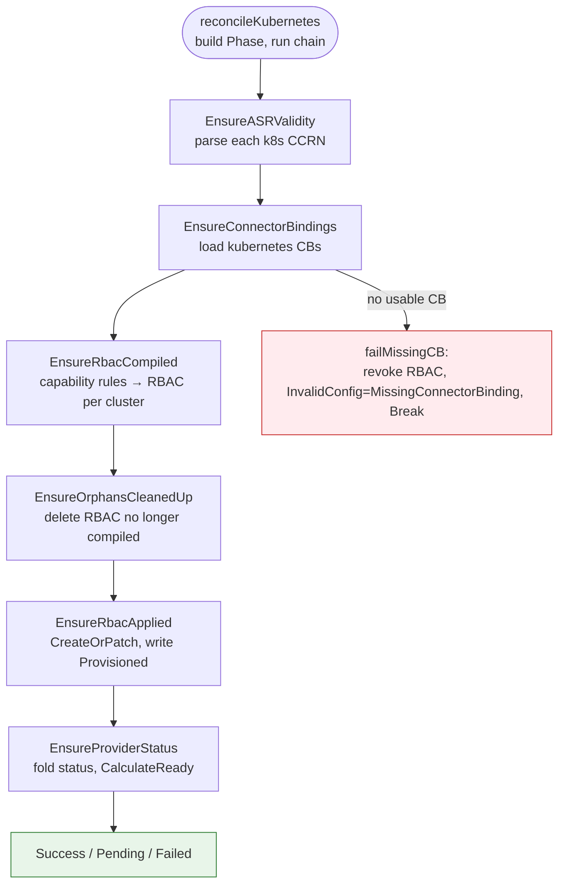
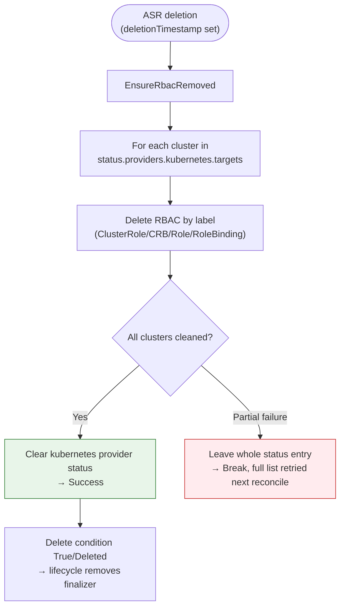
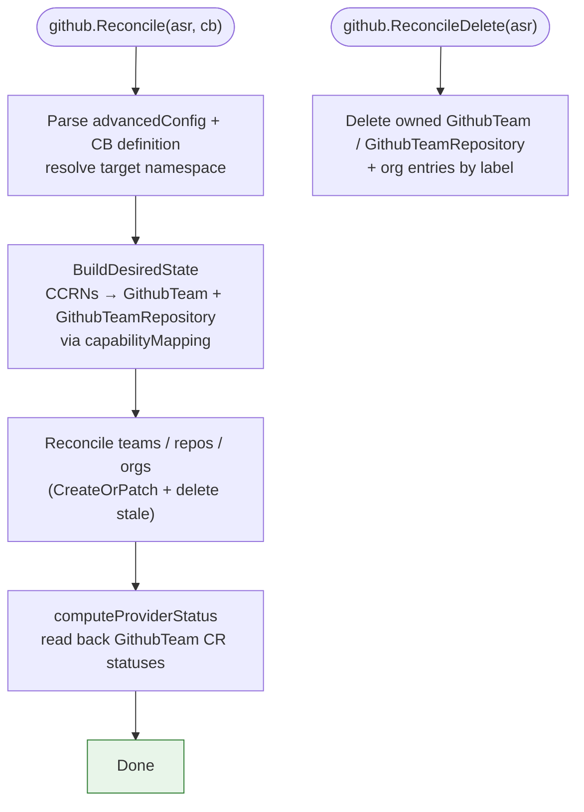

# Reconciler Flows

Visual diagrams of the permission-manager controller's reconciliation logic. A
single controller (`ASRReconciler`) watches `ApplicationSpecificRole` (ASR) and
its referenced `ConnectorBinding` resources and reconciles both providers from
one reconcile loop.

> **Code links**: Diagram nodes and the source index link directly to the file
> that implements each step. Click any linked node to jump to the source.

---

## 1. Controller & Provider Overview

There is one controller, not one per provider. `ASRReconciler.Reconcile`
delegates to the shared lifecycle engine, which routes to `EnsureCreated` or
`EnsureDeleted` depending on the deletion timestamp. Both entry points fan out
to the enabled providers.

- **Providers:** `kubernetes` and `github`. Each lives under
  [`internal/provider/`](https://github.com/cloudoperators/permission-manager/blob/main/internal/provider);
  there is no separate greenhouse-teams provider and no standalone
  status-aggregator controller.
- **Provider routing** is decided two ways: globally by
  `r.Cfg.Enabled("kubernetes" | "github")` (the `pm-provider-cm` ConfigMap), and
  per ASR by each referenced ConnectorBinding's `spec.provider`.
- **One shared finalizer** governs deletion for the whole ASR:
  `pm.cloudoperators.dev/cleanup`. Providers do not each hold their own finalizer.



---

## 2. CRD Relationships & Data Flow

How the Custom Resources relate to each other and what each provider produces.

### Input: what the user defines

```
┌─────────────────────────────────────────────────────────────────┐
│  ApplicationSpecificRole (ASR)                                    │
│                                                                   │
│  spec:                                                            │
│    connectorRefs: [sci-k8s, some-github-cb]                       │
│    permissions:                                                   │
│      - resource: urn:ccrn:cluster.k8s.../v1/nw-a-*                │
│        capability: READ                                           │
│      - resource: urn:ccrn:namespace.k8s.../v1/nw-a-prod/monitoring│
│        capability: WRITE                                          │
└──────────────────────────┬────────────────────────────────────────┘
                           │ connectorRefs
                           ▼
┌─────────────────────────────────────────────────────────────────┐
│  ConnectorBinding                                                 │
│                                                                   │
│  spec:                                                            │
│    provider: kubernetes | github                                  │
│    definition:                                                    │
│      capabilityMapping: {READ: [...rules...], WRITE: [...]}       │
└───────────────────────────────────────────────────────────────────┘
```

The `capabilityMapping` is the only source of a capability's meaning. There is
no built-in capability taxonomy in the controller: `READ`, `WRITE`, and any
other capability name are defined entirely by the ConnectorBinding referenced by
the ASR. Whatever verbs and resources the binding maps a capability to are what
that capability grants.

### Processing: provider routing



### Output: what each provider creates

| Provider | Where | Resources created |
|----------|-------|-------------------|
| **kubernetes** | Remote target clusters | `ClusterRole pm-‹asr›` + `ClusterRoleBinding pm-‹asr›` (cluster-scoped permissions) <br/> `Role pm-‹asr›` + `RoleBinding pm-‹asr›` per namespace (namespace-scoped permissions) |
| **github** | Provider namespace (management cluster) | `GithubTeam` <br/> `GithubTeamRepository` |

Kubernetes RBAC objects carry ownership labels for discovery and cleanup:

```yaml
labels:
  app.kubernetes.io/managed-by: pm-controller
  permission-manager.cloudoperators.dev/asr: <asr-name>
```

The RBAC subject is always `Kind: Group, Name: <asr.spec.name>`. GitHub-owned
resources are labelled `app.kubernetes.io/managed-by: github` plus
`permission-manager.cloudoperators.dev/source-asr` and
`.../source-namespace`.

---

## 3. Lifecycle & Subroutine Engine

Both providers run inside the shared lifecycle engine. Understanding it once
explains the finalizer, status patching, and how a provider's subroutine chain
maps to a reconcile outcome.

### Lifecycle wrapper

[`lifecycle.Reconcile`](https://github.com/cloudoperators/permission-manager/blob/main/internal/lifecycle/reconcile.go):

1. Load the ASR (ignore not-found).
2. If not being deleted and the finalizer is absent, add
   `pm.cloudoperators.dev/cleanup` and return.
3. If being deleted: once the `Delete` condition is `True`/`Deleted`, remove the
   finalizer and let the API server complete deletion; otherwise run
   `EnsureDeleted`.
4. Otherwise run `EnsureCreated`.
5. `patchStatus` writes the ASR status subresource.

`EnsureCreated` runs the **github** provider first (per referenced
ConnectorBinding whose `spec.provider == github`), then the **kubernetes**
provider (`reconcileKubernetes`). `EnsureDeleted` mirrors this: github
`ReconcileDelete`, then kubernetes `cleanUpKubernetes`. The github step
short-circuits the reconcile: if any referenced github binding errors,
`EnsureCreated`/`EnsureDeleted` return `Failed` immediately and the kubernetes
provider does not run this reconcile (it runs on the next attempt once github
succeeds).

### Subroutine engine

The kubernetes provider expresses its work as an ordered `[]SubRoutine` run by
[`ExecuteSubRoutine`](https://github.com/cloudoperators/permission-manager/blob/main/internal/lifecycle/subroutine.go).
Each subroutine returns a `Result`, mapped to a `ReconcileResult`:

| Subroutine returns | Chain behaviour | ReconcileResult |
|--------------------|-----------------|-----------------|
| `Continue()` | run the next subroutine | (keep going) |
| `Break()` or non-nil error | stop | `Failed` |
| `PendingResult()` or `RequeueAfter > 0` | stop, requeue | `Pending` |
| all subroutines `Continue` | chain complete | `Success` |

---

## 4. Kubernetes Provider - Create/Update

`reconcileKubernetes` builds a fresh `Phase` and runs six subroutines in order.
The `Phase` fetches its own ConnectorBindings; the controller passes only the
ASR.



**`EnsureASRValidity`** ([`ensure_validity.go`](https://github.com/cloudoperators/permission-manager/blob/main/internal/provider/k8s/ensure_validity.go))
parses each kubernetes CCRN. Hard parse failures and **namespace wildcards**
(unsupported) are collected into `invalidCCRNs` and stamped
`InvalidConfig=True` with reason `InvalidCCRN`. The subroutine still
`Continue`s so status is written for the valid remainder.

**`EnsureConnectorBindings`** ([`ensure_bindings.go`](https://github.com/cloudoperators/permission-manager/blob/main/internal/provider/k8s/ensure_bindings.go))
loads the CBs named in `spec.connectorRefs`, keeping those with
`spec.provider == kubernetes`. It requires at least one parseable binding with a
non-empty `capabilityMapping`. If none is usable, `failMissingCB` revokes RBAC
from previously-targeted clusters, stamps `InvalidConfig=True` with reason
`MissingConnectorBinding`, removes `Provisioned`, and `Break`s.

**`EnsureRbacCompiled`** ([`ensure_compiled.go`](https://github.com/cloudoperators/permission-manager/blob/main/internal/provider/k8s/ensure_compiled.go))
turns each permission into RBAC. It looks the capability up in the binding
(`UnionRulesForCapability`), matches the CCRN's cluster pattern against the
Greenhouse `Cluster` store (`matchClusterPattern`, exact key or trailing-`*`
glob), and splits by scope: a cluster CCRN (empty namespace) accumulates
cluster-scoped rules into `ClusterRole pm-‹asr›`; a namespace CCRN accumulates
per-namespace rules into `Role pm-‹asr›` in that namespace. This is the design
chosen in [ADR-015](adr/015-scope-separated-clusterroles.md). Three failure
accumulators are set here and each stamps `InvalidConfig=True` + `Ready=False`
directly in this subroutine: capabilities not found in any binding
(`unmappedCaps` -> reason `UnknownCapability`), cluster patterns that match
nothing (`unmatchedClusterPatterns` -> `NoTargetsResolved`), and clusters whose
deny-driven rules could not be expanded because discovery was unavailable
(`discoveryDegraded` -> `DiscoveryUnavailable`). The subroutine still
`Continue`s.

> **Deny-driven capabilities (`excludeResources`).** A capability rule may carry
> `excludeResources` instead of literal resources (see
> [Concepts → Deny-driven rules](concepts.md#deny-driven-rules-excluderesources)). For each target
> cluster, `expandRuleForCluster` ([`expand.go`](https://github.com/cloudoperators/permission-manager/blob/main/internal/provider/k8s/expand.go))
> reads the cluster's discovered API groups from
> `Cluster.status.discoveryCache.groups` and performs live discovery
> (`ServerResourcesForGroupVersion`) to enumerate each denied group's resources
> minus the excluded ones. It is **fail-closed**: if discovery is unavailable it
> returns an error and no rules, so a denied resource can never leak through a
> partial expansion. The cluster is recorded in `discoveryDegraded`.

**`EnsureOrphansCleanedUp`** ([`ensure_orphans_removed.go`](https://github.com/cloudoperators/permission-manager/blob/main/internal/provider/k8s/ensure_orphans_removed.go))
runs before apply. For a cluster no longer targeted at all, it deletes every
RBAC object carrying this ASR's `permission-manager.cloudoperators.dev/asr`
label. Within a still-targeted cluster, it removes sub-resources that dropped
out of the compiled set via `deleteSpecificRBAC`, which only deletes objects
named exactly `pm-‹asr›`; a differently-named legacy object is left for the
delete path.

**`EnsureRbacApplied`** ([`ensure_applied.go`](https://github.com/cloudoperators/permission-manager/blob/main/internal/provider/k8s/ensure_applied.go))
applies the compiled RBAC with `CreateOrPatch`. A `RoleBinding`'s `roleRef` is
immutable, so a roleRef change forces delete-and-recreate. It writes the
`Provisioned` condition with reason `ProvisioningSucceeded`, `NoTargets`,
`ProvisioningFailed`, or `PartialProvisioning`. When `InvalidConfig=True`, apply
is skipped and any stale `Provisioned` condition is removed.

**`EnsureProviderStatus`** ([`ensure_status.go`](https://github.com/cloudoperators/permission-manager/blob/main/internal/provider/k8s/ensure_status.go))
is terminal. If any of `unmappedCaps`, `invalidCCRNs`, or
`unmatchedClusterPatterns` is non-empty it writes a degraded
`status.providers.kubernetes` in place of the per-target view (note this fold
does not include `discoveryDegraded`, which already set `InvalidConfig` in the
compile step); otherwise it writes the per-cluster target statuses. It then
calls `asr.CalculateReady()` and aggregates provision/orphan errors; a non-nil
aggregate `Break`s the chain.

---

## 5. Kubernetes Provider - Deletion

Deletion is governed by the shared lifecycle finalizer, not a provider-held one.
There is no abandon-cleanup annotation and no escalating finalizer-hold. When the
ASR has a deletion timestamp, `cleanUpKubernetes` runs a single subroutine.



`EnsureRbacRemoved` iterates the clusters recorded in
`status.providers.kubernetes.targets` and deletes label-matched RBAC on each. It
clears the kubernetes provider status entry only when **every** cluster
succeeds, which lets the lifecycle engine mark the `Delete` condition
`True`/`Deleted` and remove the finalizer. If any cluster fails, the whole
provider status entry (including the clusters that were cleaned) is left in place
and the subroutine `Break`s, so the entire target list is retried on the next
reconcile.

---

## 6. GitHub Provider - Reconcile & Delete

The github provider ([`internal/provider/github/phase.go`](https://github.com/cloudoperators/permission-manager/blob/main/internal/provider/github/phase.go))
runs once per referenced `github` ConnectorBinding.



`GithubTeam` and `GithubTeamRepository` are repo-guard CRDs; the github provider
writes them and reads their status back rather than talking to GitHub directly.

---

## 7. Status Model

There is no separate aggregator controller. Each provider writes its own slice
of `status.providers.<provider>` in-process during the same reconcile, and
`Ready` is derived from the ASR's conditions.

- The kubernetes provider writes `status.providers.kubernetes` in
  `EnsureProviderStatus`; the github provider writes
  `status.providers.github` in `computeProviderStatus`.
- [`CalculateReady`](https://github.com/cloudoperators/permission-manager/blob/main/api/v1alpha1/applicationspecificrole_types.go):
  `InvalidConfig=True` wins as `Ready=False`; otherwise `Ready` mirrors
  `Provisioned`. `Ready` is a mirror and never carries an independent reason.
- `lifecycle.patchStatus` persists the status subresource once per reconcile.

Because a single controller writes the whole status object in one reconcile,
there is no cross-writer field-ownership arrangement between providers.

---

## Source File Index

Quick reference for the implementation files behind each section:

| Section | Primary source | Key symbols |
|---------|----------------|-------------|
| **Controller & routing** | [`internal/controller/asr_controller.go`](https://github.com/cloudoperators/permission-manager/blob/main/internal/controller/asr_controller.go) | `ASRReconciler`, `Reconcile`, `EnsureCreated`, `EnsureDeleted`, `reconcileKubernetes`, `cleanUpKubernetes` |
| **Lifecycle engine** | [`internal/lifecycle/reconcile.go`](https://github.com/cloudoperators/permission-manager/blob/main/internal/lifecycle/reconcile.go) | `Reconcile`, `ensureFinalizer`, `patchStatus`, `commonCleanupFinalizer` |
| **Subroutine engine** | [`internal/lifecycle/subroutine.go`](https://github.com/cloudoperators/permission-manager/blob/main/internal/lifecycle/subroutine.go) | `ExecuteSubRoutine`, `Continue`, `Break`, `PendingResult`, `RequeueAfter` |
| **K8s - validity** | [`internal/provider/k8s/ensure_validity.go`](https://github.com/cloudoperators/permission-manager/blob/main/internal/provider/k8s/ensure_validity.go) | `EnsureASRValidity` |
| **K8s - bindings** | [`internal/provider/k8s/ensure_bindings.go`](https://github.com/cloudoperators/permission-manager/blob/main/internal/provider/k8s/ensure_bindings.go) | `EnsureConnectorBindings`, `failMissingCB` |
| **K8s - compile** | [`internal/provider/k8s/ensure_compiled.go`](https://github.com/cloudoperators/permission-manager/blob/main/internal/provider/k8s/ensure_compiled.go) | `EnsureRbacCompiled`, `buildClusterScopedRBAC`, `buildNamespaceScopedRBAC`, `matchClusterPattern` |
| **K8s - deny expansion** | [`internal/provider/k8s/expand.go`](https://github.com/cloudoperators/permission-manager/blob/main/internal/provider/k8s/expand.go) | `expandRuleForCluster` |
| **K8s - orphans / delete** | [`internal/provider/k8s/ensure_orphans_removed.go`](https://github.com/cloudoperators/permission-manager/blob/main/internal/provider/k8s/ensure_orphans_removed.go) | `EnsureOrphansCleanedUp`, `EnsureRbacRemoved`, `deleteRBACByLabel` |
| **K8s - apply** | [`internal/provider/k8s/ensure_applied.go`](https://github.com/cloudoperators/permission-manager/blob/main/internal/provider/k8s/ensure_applied.go) | `EnsureRbacApplied` |
| **K8s - status** | [`internal/provider/k8s/ensure_status.go`](https://github.com/cloudoperators/permission-manager/blob/main/internal/provider/k8s/ensure_status.go) | `EnsureProviderStatus`, `writeProviderStatus` |
| **GitHub** | [`internal/provider/github/phase.go`](https://github.com/cloudoperators/permission-manager/blob/main/internal/provider/github/phase.go) | `Reconcile`, `ReconcileDelete` |
| **GitHub - desired state** | [`internal/provider/github/desired_state.go`](https://github.com/cloudoperators/permission-manager/blob/main/internal/provider/github/desired_state.go) | `BuildDesiredState` |
| **GitHub - status** | [`internal/provider/github/status.go`](https://github.com/cloudoperators/permission-manager/blob/main/internal/provider/github/status.go) | `computeProviderStatus` |
| **Ready computation** | [`api/v1alpha1/applicationspecificrole_types.go`](https://github.com/cloudoperators/permission-manager/blob/main/api/v1alpha1/applicationspecificrole_types.go) | `CalculateReady` |
