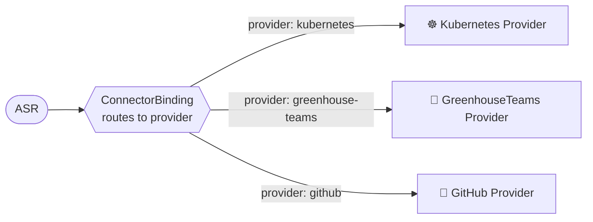
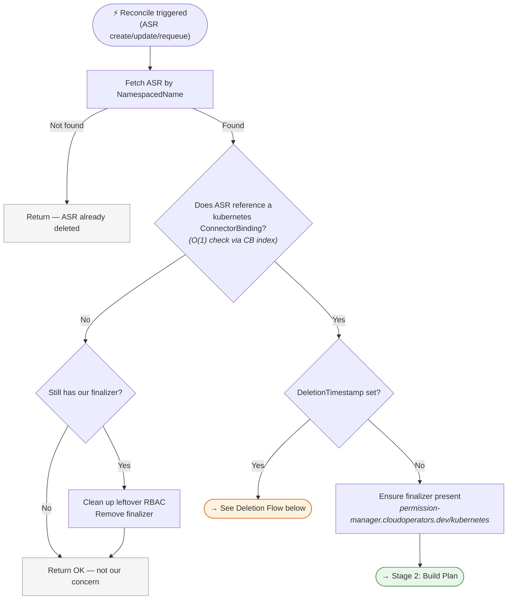
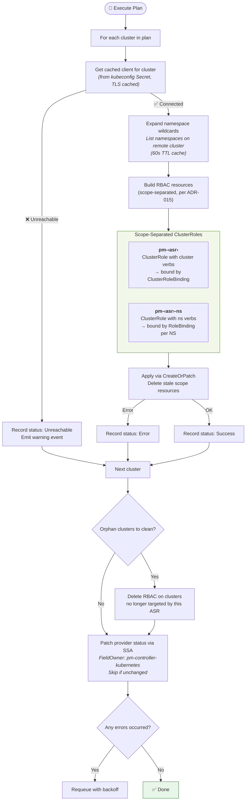
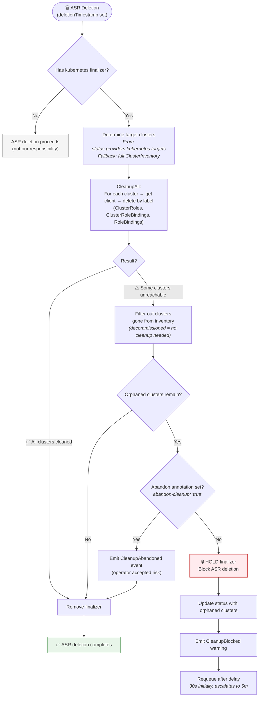
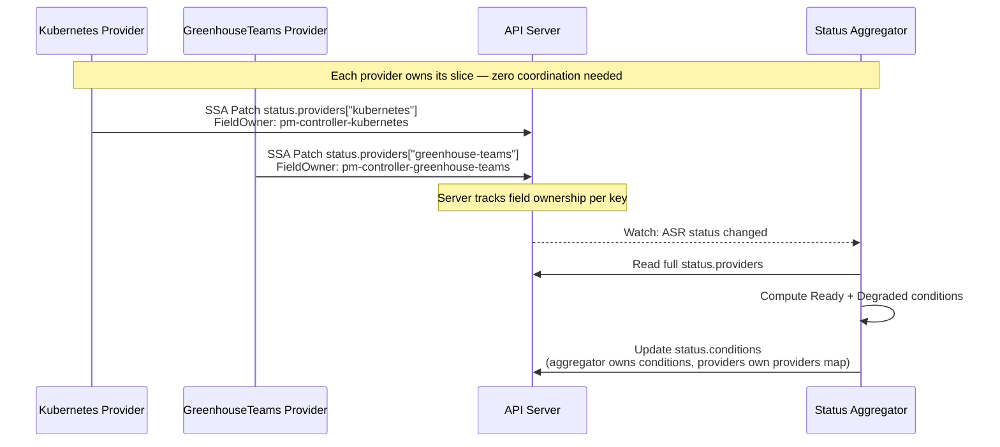

# Reconciler Flows

Visual diagrams of the pm-controller's reconciliation logic. Each provider is an independent binary with its own reconciler loop.

---

## 1. CRD Relationships & Data Flow

How the Custom Resources relate to each other and what each provider produces.

### Input: What the user defines

```
┌─────────────────────────────────────────────────────────────────┐
│  ApplicationSpecificRole (ASR)                                  │
│                                                                 │
│  spec:                                                          │
│    connectorRefs: [cb-kubernetes, cb-greenhouse-teams]           │
│    permissions:                                                  │
│      - resource: urn:ccrn:cluster.k8s.../v1/nw-a-*              │
│        capability: READ                                         │
│      - resource: urn:ccrn:namespace.k8s.../v1/*/monitoring      │
│        capability: WRITE                                        │
└──────────────────────────┬──────────────────────────────────────┘
                           │ references
                           ▼
┌─────────────────────────────────────────────────────────────────┐
│  ConnectorBinding                                               │
│                                                                 │
│  spec:                                                          │
│    provider: kubernetes | github | greenhouse-teams              │
│    definition:                                                   │
│      capabilityMapping: {READ: cluster-viewer, WRITE: admin}    │
│      defaultTargetNamespace: greenhouse-org-foo                  │
└──────────────────────────┬──────────────────────────────────────┘
                           │ credentials from
                           ▼
┌─────────────────────────────────────────────────────────────────┐
│  Secret (per cluster)                                           │
│                                                                 │
│  data:                                                          │
│    greenhousekubeconfig: <base64 kubeconfig>                    │
└─────────────────────────────────────────────────────────────────┘
```

### Processing: Provider routing



### Output: What each provider creates

| Provider | Where | Resources Created |
|----------|-------|-------------------|
| **kubernetes** | Remote target clusters | `ClusterRole pm-‹asr›` (cluster verbs) <br/> `ClusterRole pm-‹asr›-ns` (namespace verbs) <br/> `ClusterRoleBinding pm-‹asr›` <br/> `RoleBinding pm-‹asr›` (per namespace) |
| **greenhouse-teams** | Greenhouse org namespace (management cluster) | `Team pm-‹teamName›` <br/> `TeamRoleBinding pm-‹asr›-‹role›-‹cluster›` |
| **github** | Provider namespace (management cluster) | `GithubTeam` <br/> `GithubTeamRepository` |
| **status-aggregator** | ASR status (management cluster) | `status.conditions[Ready, Degraded]` |

All output resources carry ownership labels for discovery and cleanup:
```yaml
labels:
  managed-by: pm-controller          # or pm-greenhouse-teams
  permission-manager.cloudoperators.dev/asr: <asr-name>
```

---

## 2. Kubernetes Provider — Create/Update Reconcile

The reconcile loop is split into three stages for clarity.

### Stage 1: Filtering & Setup



### Stage 2: Plan Construction


### Stage 3: Execute Plan



---

## 3. Kubernetes Provider — Deletion Flow

When an ASR is deleted, the finalizer blocks removal until all RBAC is confirmed cleaned.



**Three exit paths (per ADR-012):**

| # | Condition | Outcome |
|---|-----------|---------|
| 1 | All clusters cleaned successfully | Finalizer removed → deletion proceeds |
| 2 | Cluster gone from Greenhouse inventory | Treated as cleaned (no cleanup needed) → finalizer removed |
| 3 | Operator sets `abandon-cleanup: "true"` | Explicit risk acceptance → finalizer removed despite orphans |

If none of these exit paths are met, the **finalizer is held** — the ASR cannot be deleted while RBAC may still be active on unreachable clusters. The controller retries with escalating delays.

---

## 4. GreenhouseTeams Provider — Reconcile Flow


---

## 5. Status Aggregator

The aggregator is provider-agnostic — it only reads the `status.providers` map and computes top-level conditions.


---

## 6. Status Ownership Model (SSA)

How multiple independent controllers write to the same ASR without conflicts.


