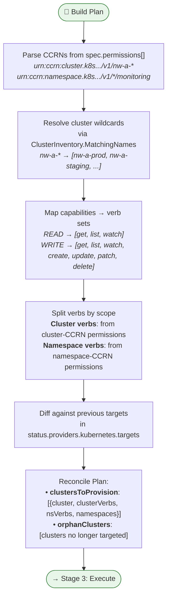
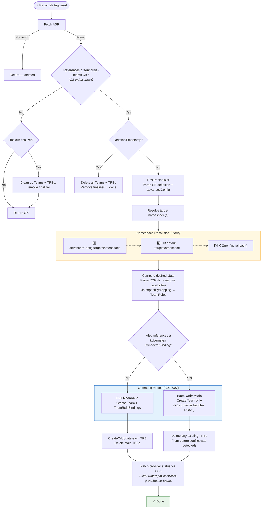
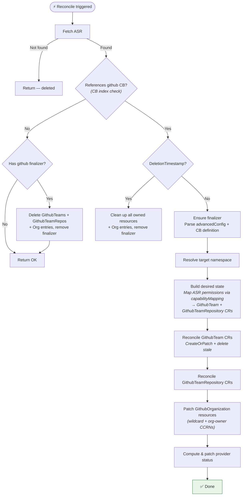
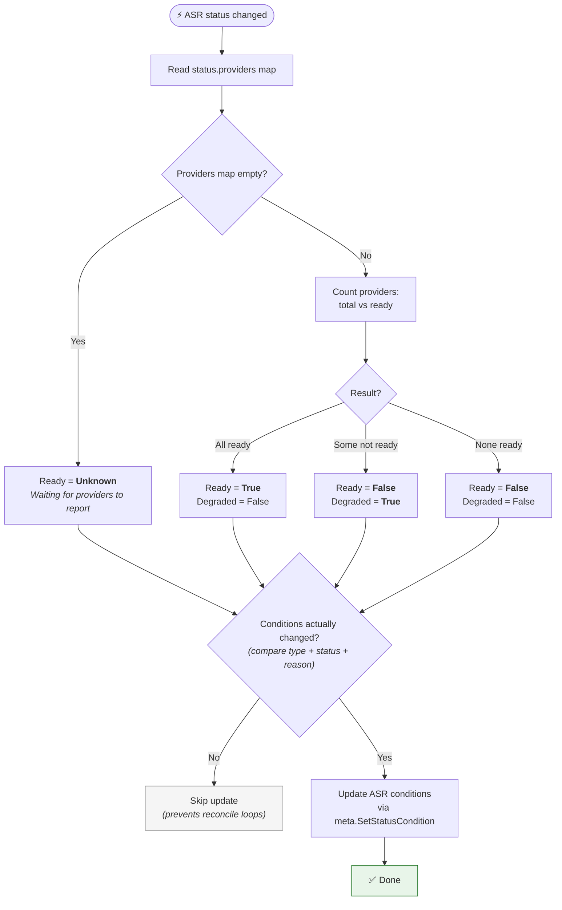
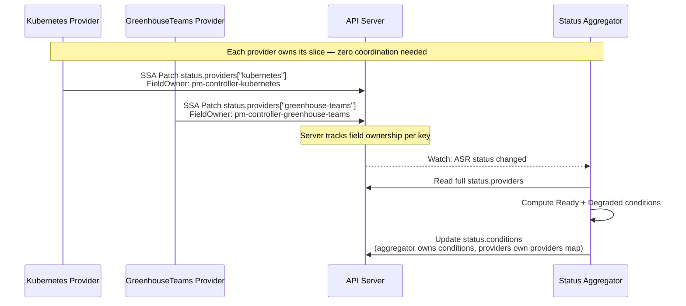

# Reconciler Flows

Visual diagrams of the pm-controller's reconciliation logic. Each provider is an independent binary with its own reconciler loop.

> **📍 Code links**: Diagram nodes link directly to the source code that implements that step. Click any highlighted node to jump to the relevant file and line.

---

## 1. CRD Relationships & Data Flow

How the Custom Resources relate to each other and what each provider produces.

### Input: What the user defines

```
┌─────────────────────────────────────────────────────────────────┐
│  ApplicationSpecificRole (ASR)                                  │
│                                                                 │
│  spec:                                                          │
│    connectorRefs: [cb-kubernetes, cb-greenhouse-teams]           │
│    permissions:                                                  │
│      - resource: urn:ccrn:cluster.k8s.../v1/nw-a-*              │
│        capability: READ                                         │
│      - resource: urn:ccrn:namespace.k8s.../v1/*/monitoring      │
│        capability: WRITE                                        │
└──────────────────────────┬──────────────────────────────────────┘
                           │ references
                           ▼
┌─────────────────────────────────────────────────────────────────┐
│  ConnectorBinding                                               │
│                                                                 │
│  spec:                                                          │
│    provider: kubernetes | github | greenhouse-teams              │
│    definition:                                                   │
│      capabilityMapping: {READ: cluster-viewer, WRITE: admin}    │
│      defaultTargetNamespace: greenhouse-org-foo                  │
└──────────────────────────┬──────────────────────────────────────┘
                           │ credentials from
                           ▼
┌─────────────────────────────────────────────────────────────────┐
│  Secret (per cluster)                                           │
│                                                                 │
│  data:                                                          │
│    greenhousekubeconfig: <base64 kubeconfig>                    │
└─────────────────────────────────────────────────────────────────┘
```

### Processing: Provider routing


### Output: What each provider creates

| Provider | Where | Resources Created |
|----------|-------|-------------------|
| **kubernetes** | Remote target clusters | `ClusterRole pm-‹asr›` (cluster verbs) <br/> `ClusterRole pm-‹asr›-ns` (namespace verbs) <br/> `ClusterRoleBinding pm-‹asr›` <br/> `RoleBinding pm-‹asr›` (per namespace) |
| **greenhouse-teams** | Greenhouse org namespace (management cluster) | `Team pm-‹teamName›` <br/> `TeamRoleBinding pm-‹asr›-‹role›-‹cluster›` |
| **github** | Provider namespace (management cluster) | `GithubTeam` <br/> `GithubTeamRepository` |
| **status-aggregator** | ASR status (management cluster) | `status.conditions[Ready, Degraded]` |

All output resources carry ownership labels for discovery and cleanup:
```yaml
labels:
  managed-by: pm-controller          # or pm-greenhouse-teams
  permission-manager.cloudoperators.dev/asr: <asr-name>
```

---

## 2. Kubernetes Provider — Create/Update Reconcile

The reconcile loop is split into three stages for clarity.

### Stage 1: Filtering & Setup


### Stage 2: Plan Construction



### Stage 3: Execute Plan


---

## 3. Kubernetes Provider — Deletion Flow

When an ASR is deleted, the finalizer blocks removal until all RBAC is confirmed cleaned.


**Three exit paths (per ADR-012):**

| # | Condition | Outcome |
|---|-----------|---------|
| 1 | All clusters cleaned successfully | Finalizer removed → deletion proceeds |
| 2 | Cluster gone from Greenhouse inventory | Treated as cleaned (no cleanup needed) → finalizer removed |
| 3 | Operator sets `abandon-cleanup: "true"` | Explicit risk acceptance → finalizer removed despite orphans |

If none of these exit paths are met, the **finalizer is held** — the ASR cannot be deleted while RBAC may still be active on unreachable clusters. The controller retries with escalating delays.

---

## 4. GreenhouseTeams Provider — Reconcile Flow



---

## 5. GitHub Provider — Reconcile Flow



---

## 6. Status Aggregator

The aggregator is provider-agnostic — it only reads the `status.providers` map and computes top-level conditions.



---

## 7. Status Ownership Model (SSA)

How multiple independent controllers write to the same ASR without conflicts.



---

## Source File Index

Quick reference for the implementation files behind each diagram:

| Diagram | Primary Source | Key Functions |
|---------|---------------|---------------|
| **K8s Provider — Stage 1** | [`kubernetes/reconciler.go`](controller/internal/controller/kubernetes/reconciler.go) | `Reconcile` (L77), `SetupWithManager` (L360) |
| **K8s Provider — Stage 2** | [`kubernetes/reconcile_plan.go`](controller/internal/controller/kubernetes/reconcile_plan.go) | `planReconcile` (L34), `ReconcilePlan` struct (L19) |
| **K8s Provider — Stage 3** | [`kubernetes/reconcile_plan.go`](controller/internal/controller/kubernetes/reconcile_plan.go) | `executeReconcilePlan` (L57) |
| **K8s Provider — RBAC gen** | [`kubernetes/rbac_generator.go`](controller/internal/controller/kubernetes/rbac_generator.go) | `buildRBACPlan`, `applyRBACPlan` |
| **K8s Provider — Deletion** | [`kubernetes/rbac_cleaner.go`](controller/internal/controller/kubernetes/rbac_cleaner.go) | `CleanupAll`, `CleanupOrphans` |
| **K8s Provider — Orphan** | [`kubernetes/orphan_cleanup.go`](controller/internal/controller/kubernetes/orphan_cleanup.go) | `filterOrphanedClusters`, orphan status |
| **GreenhouseTeams** | [`greenhouseteams/reconciler.go`](controller/internal/controller/greenhouseteams/reconciler.go) | `Reconcile` (L38) |
| **GreenhouseTeams — Conflict** | [`greenhouseteams/conflict.go`](controller/internal/controller/greenhouseteams/conflict.go) | `DetermineMode` (L87), `CleanupTRBs` (L106) |
| **GreenhouseTeams — Teams** | [`greenhouseteams/team.go`](controller/internal/controller/greenhouseteams/team.go) | `ReconcileTeam` |
| **GreenhouseTeams — TRBs** | [`greenhouseteams/teamrolebinding.go`](controller/internal/controller/greenhouseteams/teamrolebinding.go) | `ReconcileAllTRBs` |
| **GitHub** | [`github/reconciler.go`](controller/internal/controller/github/reconciler.go) | `Reconcile` (L41) |
| **GitHub — Desired State** | [`github/desired_state.go`](controller/internal/controller/github/desired_state.go) | `BuildDesiredState` |
| **GitHub — Teams** | [`github/github_team.go`](controller/internal/controller/github/github_team.go) | `ReconcileTeams` |
| **GitHub — Orgs** | [`github/github_org.go`](controller/internal/controller/github/github_org.go) | `reconcileOrganizations` |
| **Status Aggregator** | [`aggregator/reconciler.go`](controller/internal/controller/aggregator/reconciler.go) | `Reconcile` (L37), `computeConditions` (L99) |
