# Threat Model: pm-controller (Kubernetes Provider)

**Version:** 1.0  
**Date:** 2026-06-09  
**Scope:** pm-controller Kubernetes RBAC provider — management cluster to remote cluster RBAC provisioning

---

## 1. System Overview

The `pm-controller` is a multi-provider Kubernetes controller that runs on a **management cluster** (Greenhouse platform) and provisions access control resources on **remote/consumer clusters**. The Kubernetes provider specifically:

1. Watches `ApplicationSpecificRole` (ASR) and `ConnectorBinding` custom resources on the management cluster.
2. Reads kubeconfig `Secrets` to obtain credentials for remote clusters.
3. Translates ASR permissions (CCRN resource + capability pairs) into Kubernetes RBAC resources (ClusterRoles, ClusterRoleBindings, RoleBindings).
4. Applies those RBAC resources to the appropriate remote clusters using Server-Side Apply / MergeFrom patches.
5. Cleans up RBAC resources when ASRs are deleted or permissions change, using a finalizer-guarded deletion strategy.

The controller supports wildcard patterns in cluster names and namespace names (e.g., `nw-a-*`), matching against a live `ClusterInventory` built from Greenhouse `Cluster` CRs.

---

## 2. Trust Boundaries

```mermaid
graph TB
    subgraph "Management Cluster (Greenhouse)"
        subgraph "Controller Namespace"
            PM[pm-controller Pod]
            SA[ServiceAccount: pm-controller-kubernetes]
            VWH[Validating Admission Webhook<br/>writer-identity enforcement]
        end
        
        subgraph "Watched Namespace (Org Namespace)"
            ASR[ApplicationSpecificRoles]
            CB[ConnectorBindings]
            SEC[Kubeconfig Secrets]
            GC[Greenhouse Cluster CRs]
        end
        
        PM -->|reads| ASR
        PM -->|reads| CB
        PM -->|reads| SEC
        PM -->|reads| GC
        PM -->|patches status| ASR
        VWH -.->|guards mutations| ASR
        VWH -.->|guards mutations| CB
    end
    
    subgraph "Remote Cluster A"
        CRA[ClusterRole: pm-asr-name]
        CRBA[ClusterRoleBinding: pm-asr-name]
        RBA[RoleBindings: pm-asr-name per ns]
    end
    
    subgraph "Remote Cluster B"
        CRB_B[ClusterRole: pm-asr-name]
        CRBB_B[ClusterRoleBinding: pm-asr-name]
        RBB_B[RoleBindings: pm-asr-name per ns]
    end
    
    PM ==>|"kubeconfig credentials<br/>(Trust Boundary 1)"| CRA
    PM ==>|"kubeconfig credentials<br/>(Trust Boundary 1)"| CRB_B
    
    AutomationUser([Automation User<br/>e.g. ArgoCD SA]) -->|"creates/updates<br/>(allowed by webhook)"| ASR
    AutomationUser -->|"creates/updates<br/>(allowed by webhook)"| CB
    RejectedUser([Other Users<br/>namespace editors]) -.-x|"blocked by webhook<br/>even with RBAC"| VWH
    SecretAuthor([Secret Author<br/>Greenhouse platform]) -->|creates/updates| SEC
    ClusterAdmin([Cluster Admin<br/>management cluster]) -->|full access| PM
    
    style PM fill:#f9f,stroke:#333
    style SEC fill:#faa,stroke:#333
    style VWH fill:#afa,stroke:#333
```



### Trust Boundary Summary

| Boundary | Description |
|----------|-------------|
| **TB-1: Management → Remote** | The controller authenticates to remote clusters using credentials from Secrets. These Secrets are the highest-sensitivity assets. |
| **TB-2: Namespace → Cluster scope** | ASR authors have namespace-scoped access on the management cluster but their ASRs can produce cluster-scoped RBAC on remote clusters. |
| **TB-3: CRD authors → RBAC output** | The content of ASR and ConnectorBinding CRDs directly determines what RBAC is provisioned on remote clusters. |
| **TB-4: Admission gate (webhook)** | The validating webhook enforces that only designated automation principals (e.g., ArgoCD SA) can mutate permission-manager CRDs. Bypassing it requires cluster-admin access to modify the `ValidatingWebhookConfiguration`. |

---

## 3. Assets

| Asset | Sensitivity | Location | Impact if Compromised |
|-------|-------------|----------|----------------------|
| **Remote cluster RBAC** (ClusterRoles, Bindings) | High | Remote clusters | Unauthorized access to workloads, data exfiltration, privilege escalation on consumer clusters |
| **Kubeconfig Secrets** | Critical | Management cluster (watched namespace) | Full API access to remote clusters with the credential stored in the Secret |
| **Controller ServiceAccount token** | High | Controller pod | Read access to all Secrets, CRDs; write access to ASR status/finalizers; ability to modify RBAC on all remote clusters |
| **ASR integrity** | Medium | Management cluster | Unauthorized permissions granted to subjects on remote clusters |
| **ConnectorBinding integrity** | Medium | Management cluster | Routing ASRs to unintended providers; altering capability mappings |
| **ClusterInventory state** | Low-Medium | In-memory (controller) | Incorrect cluster targeting; stale RBAC on removed clusters |

---

## 4. Principals & Access Levels

| Principal | Typical Role | Management Cluster Access | Influence on RBAC Output |
|-----------|-------------|--------------------------|--------------------------|
| **ASR Authors** | Team leads, service owners | `create/update/delete` on ASRs in their namespace | Define which subjects get which capabilities on which clusters/namespaces |
| **ConnectorBinding Authors** | Platform administrators | `create/update/delete` on ConnectorBindings | Define which provider handles which connector name; gate which ASRs are kubernetes-relevant |
| **Secret Authors** | Greenhouse platform controller (automated) | `create/update` on Secrets in the watched namespace | Provide credentials for remote cluster access; control which clusters are reachable |
| **Management Cluster Admins** | SRE / platform team | Full cluster-admin | Can modify controller deployment, RBAC, secrets, CRDs; highest trust level |
| **Remote Cluster Admins** | Consumer cluster operators | Admin on their own cluster | Can observe/delete pm-controller-generated RBAC; cannot influence management cluster |

---

## 5. Threat Catalog

### T1: Remote Code Execution via Exec Credential Plugins in Kubeconfig Secrets

| Field | Value |
|-------|-------|
| **ID** | T1 |
| **STRIDE** | Elevation of Privilege |
| **Attack Vector** | An attacker with `create` or `update` on Secrets in the controller's watched namespace crafts a kubeconfig containing `users[].user.exec` or `users[].user.auth-provider` stanzas. When the controller processes this Secret, client-go invokes the specified binary inside the controller pod. |
| **Impact** | Arbitrary code execution in the controller pod with the controller's ServiceAccount privileges (read all Secrets, write RBAC to all remote clusters). |
| **Mitigation** | **ADR-014**: The `GreenhouseClusterClientFactory.ClientForCluster()` explicitly rejects `rest.Config` objects where `ExecProvider != nil` or `AuthProvider != nil`, returning a `ClusterUnreachableError` before any transport-layer code is invoked. Additionally, **signed container images** (Layer 6) ensure that even if RCE were achieved, the attacker cannot persist a backdoor by replacing the controller image — the admission-time signature check would reject unsigned images on the next pod restart. |
| **Residual Risk** | Low. The check happens post-parse but pre-connection. An attacker with Secret write access still cannot achieve RCE through this path. However, they can still create Secrets with valid static credentials pointing to attacker-controlled clusters (see T5). |

---

### T2: Privilege Escalation via Verb-Merging in ClusterRoles

| Field | Value |
|-------|-------|
| **ID** | T2 |
| **STRIDE** | Elevation of Privilege |
| **Attack Vector** | An ASR with mixed-scope permissions (e.g., READ on cluster, WRITE on namespace) could result in all verbs being merged into a single ClusterRole bound cluster-wide via ClusterRoleBinding, giving namespace-scoped verbs (create/update/delete) cluster-wide reach. |
| **Impact** | Subjects receive more permissions than intended — namespace-scoped write access becomes cluster-wide write access. |
| **Mitigation** | **ADR-015**: `buildRBACPlan()` generates two scope-separated ClusterRoles per ASR per cluster: `pm-<asr>` with only cluster-scoped verbs (bound by ClusterRoleBinding) and `pm-<asr>-ns` with only namespace-scoped verbs (bound by RoleBindings per namespace). Stale counterparts are cleaned up on reconcile. |
| **Residual Risk** | Eliminated for new deployments. Brief window during migration where existing RoleBindings are deleted/recreated (roleRef is immutable). |

---

### T3: Overly Permissive Capability Mapping

| Field | Value |
|-------|-------|
| **ID** | T3 |
| **STRIDE** | Elevation of Privilege |
| **Attack Vector** | The old `MANAGE` capability mapped to `bind`, `escalate`, `impersonate` — privilege-escalation verbs that effectively grant cluster-admin. Hiding these under a generic "MANAGE" name made it easy for ASR authors to unknowingly grant escalation-capable permissions. |
| **Impact** | Subjects with MANAGE could bind any ClusterRole to themselves, escalate their own permissions, or impersonate any user/group — effectively full cluster compromise. |
| **Mitigation** | **ADR-016**: Revised `CapabilityVerbs` taxonomy isolates privilege-escalation verbs under `SECURE` (bind, escalate, impersonate). Removed MANAGE and ADMIN. Using removed capabilities surfaces as "unmapped capability" degraded status. The **admission webhook** (Layer 1) can additionally enforce content policies rejecting SECURE or `*` capability usage without an elevated approval annotation — even the automation user cannot deploy such an ASR without the annotation present in the Git-reviewed manifest. |
| **Residual Risk** | Low (with webhook content policies). Without them, Medium — the naming makes danger explicit but nothing prevents assignment by authorized automation. |

---

### T4: Unauthorized ASR Creation Granting Access to Unreachable Clusters

| Field | Value |
|-------|-------|
| **ID** | T4 |
| **STRIDE** | Elevation of Privilege / Spoofing |
| **Attack Vector** | An actor with ASR create permissions in a namespace creates an ASR referencing a Kubernetes ConnectorBinding with CCRN patterns targeting clusters they should not have access to (e.g., `urn:ccrn:cluster.k8s.ccrn.cloudoperators.dev/v1/*` for all clusters). The controller provisions RBAC on those clusters without verifying the ASR author's authority over them. |
| **Impact** | Unauthorized RBAC provisioning on clusters the ASR author has no business accessing. The subject group named in `spec.name` receives permissions on arbitrary clusters. |
| **Mitigation** | **With webhook (Layers 1–5)**: The validating admission webhook restricts CRD mutations to the designated automation SA. An unauthorized actor cannot create ASRs at all — regardless of their Kubernetes RBAC. Combined with GitOps, all ASR definitions are code-reviewed before merging. The webhook can additionally enforce content policies (e.g., reject wildcard `*` cluster patterns without an explicit approval annotation). **Without webhook**: ConnectorBindings serve as a partial gate (ASRs must reference a valid kubernetes CB), but within that scope, wildcard CCRN patterns can target all clusters. |
| **Residual Risk** | **Low** (with webhook + content policies). The remaining risk is a malicious commit in the GitOps repo that passes code review — mitigated by PR approval requirements and CODEOWNERS on ASR directories. Without the webhook: **Medium-High**. |

---

### T5: Kubeconfig Secret Tampering to Redirect RBAC to Attacker-Controlled Cluster

| Field | Value |
|-------|-------|
| **ID** | T5 |
| **STRIDE** | Tampering / Spoofing |
| **Attack Vector** | An attacker with write access to Secrets in the watched namespace modifies a kubeconfig Secret to point to an attacker-controlled API server. The controller connects and provisions RBAC resources there, revealing the ASR structure (subject names, permission patterns). Alternatively, the attacker replaces a legitimate Secret with credentials for a different cluster, causing RBAC intended for cluster A to be applied to cluster B. |
| **Impact** | Information disclosure (ASR subject/group names, permission structures), potential for confused-deputy attacks where legitimate RBAC is applied to wrong clusters. |
| **Mitigation** | **Partial**: The client cache validates against `Secret.resourceVersion`, so changes trigger re-connection. The cluster name comes from the Secret's `metadata.name` (matched against Greenhouse Cluster CR names), providing some naming validation. ADR-014 blocks exec-based attacks. **Audit logging** (Layer 4) detects Secret modifications by unexpected principals. **GitOps drift detection** (Layer 3) can also manage Secrets declaratively, reverting unauthorized changes. **Recommended enhancement**: cross-reference the `server` field in kubeconfig against the Greenhouse Cluster CR's registered API server URL (see Recommendation #2). |
| **Residual Risk** | **Medium** (without endpoint validation). Reduced to **Low** with endpoint cross-reference + GitOps-managed Secrets + audit alerts on Secret modifications. |

---

### T6: Stale RBAC After ASR Deletion (Unreachable Cluster)

| Field | Value |
|-------|-------|
| **ID** | T6 |
| **STRIDE** | Elevation of Privilege (residual access) |
| **Attack Vector** | An ASR is deleted but one or more target clusters are unreachable at cleanup time. Without proper handling, the RBAC resources remain active on those clusters, granting access that should have been revoked. |
| **Impact** | Subjects retain permissions on unreachable clusters after access was intended to be revoked — a security gap. |
| **Mitigation** | **ADR-012**: Finalizer-guarded cleanup holds the ASR's deletion until RBAC is confirmed cleaned from all clusters. Three explicit exit paths: (1) all clusters cleaned, (2) cluster removed from Greenhouse inventory (resources gone with cluster), (3) operator sets `abandon-cleanup` annotation. Orphan tracking in status provides observability. Exponential backoff requeue (30s → 5m). |
| **Residual Risk** | Low for transient failures (auto-retry). Residual risk exists when the `abandon-cleanup` annotation is used — this is a deliberate operator decision documented as accepting stale RBAC. |

---

### T7: Controller Service Account Compromise — Blast Radius

| Field | Value |
|-------|-------|
| **ID** | T7 |
| **STRIDE** | Elevation of Privilege |
| **Attack Vector** | An attacker gains access to the controller pod (container escape, supply chain attack on image, SSRF from metrics endpoint). The ServiceAccount token grants: read access to all Secrets (including kubeconfigs for all remote clusters), read/write on ASR CRDs, and the cached remote cluster credentials in memory. |
| **Impact** | Full compromise of all remote clusters reachable by stored kubeconfigs. Ability to create/modify RBAC on all clusters. Read access to all kubeconfig Secrets in the namespace. |
| **Mitigation** | **Layered**: (1) The ServiceAccount has least-privilege for its function (no write to Secrets, no cluster-admin). (2) Separate ServiceAccounts per provider limit blast radius across providers. (3) **Signed container images** (Layer 6) prevent supply-chain attacks — a tampered image is rejected at admission. (4) **Pod security context** (Recommendation #5) reduces container-escape surface (readOnlyRootFilesystem, drop all capabilities, runAsNonRoot). (5) **Network policies** (Recommendation #4) restrict egress to known API server endpoints only — a compromised pod cannot exfiltrate to arbitrary destinations. (6) The **admission webhook** prevents the compromised SA from creating malicious ASRs even if the attacker attempts to use the SA's CRD write access (the SA is not in the webhook allowlist unless it's the controller's status-patch SA, which can only write status subresources). |
| **Residual Risk** | **Medium** (with all layers). The controller inherently needs read access to all kubeconfig Secrets and write access to RBAC on all remote clusters — this blast radius is structurally irreducible. However, the attack surface for *reaching* the pod is significantly hardened (signed images, pod security, network policies), and even a compromised pod cannot escalate via CRD manipulation. Without layers: **High**. |

---

### T8: Denial of Service via Mass ASR Creation

| Field | Value |
|-------|-------|
| **ID** | T8 |
| **STRIDE** | Denial of Service |
| **Attack Vector** | An actor with ASR create access floods the namespace with ASRs targeting many clusters via wildcards. Each ASR triggers reconciliation against all matching clusters, overwhelming the controller's concurrency limit (MaxConcurrentReconciles: 2) and exhausting API server quotas on remote clusters. |
| **Impact** | Controller becomes backlogged, legitimate ASR changes are delayed. Remote cluster API servers may rate-limit the controller's credentials, causing cascading "Unreachable" statuses. |
| **Mitigation** | **With webhook (Layers 1–5)**: The admission webhook restricts CRD creation to the designated automation SA, eliminating mass-creation by unauthorized actors entirely. For the authorized automation SA, GitOps acts as a natural rate limiter (commits require review and merge). Additionally: MaxConcurrentReconciles=2 limits parallelism, and controller-runtime's rate-limited workqueue provides backpressure. ResourceQuotas on the namespace can limit object count as a secondary control. |
| **Residual Risk** | **Low** (with webhook). The only DoS path is a malicious mass-commit through the GitOps pipeline, which requires Git repo write access + bypassing PR review. Without the webhook: **Medium**. |

---

### T9: Wildcard CCRN Patterns Granting Unintended Scope

| Field | Value |
|-------|-------|
| **ID** | T9 |
| **STRIDE** | Elevation of Privilege |
| **Attack Vector** | An ASR uses broad wildcard patterns in CCRN resources (e.g., cluster name `*` or namespace `*`). The `*` namespace pattern is promoted to cluster-scoped verbs via `expandNamespaceWildcards`. A cluster name of `*` matches all clusters in the inventory. Combined with WRITE or SECURE capability, this can grant very broad access. |
| **Impact** | Subjects receive permissions across all clusters and all namespaces when the ASR author may have intended a narrower scope. |
| **Mitigation** | **With webhook (Layers 1–5)**: The admission webhook can enforce content policies that reject wildcard `*` cluster patterns or require an explicit approval annotation (e.g., `permission-manager.cloudoperators.dev/allow-wildcard-cluster=true`) that must be present in the Git-reviewed manifest. Namespace `*` promotion to cluster-scope is intentional and documented. The CCRN parser validates format. Combined with GitOps review, wildcard ASRs require explicit human approval at the PR level. |
| **Residual Risk** | **Low** (with webhook content policies + GitOps review). A reviewer could still approve an overly broad wildcard, but this is an operational/human error rather than an exploit. Without the webhook: **Medium**. |

---

### T10: Cross-Provider Interference via SSA Field Ownership

| Field | Value |
|-------|-------|
| **ID** | T10 |
| **STRIDE** | Tampering |
| **Attack Vector** | Multiple providers (kubernetes, github, greenhouse-teams) write to the same ASR's status. Without proper field ownership isolation, one provider's status patch could overwrite another's, causing incorrect status reporting or reconcile loops. |
| **Impact** | Incorrect status information; potential infinite reconcile loops; masking of failed provisioning from one provider. |
| **Mitigation** | SSA with per-provider field managers (`pm-controller-kubernetes`, `pm-controller-github`, etc.) with `ForceOwnership`. Each provider owns only its key in `status.providers[<provider>]`. The `ignoreASRStatusUpdates` predicate prevents status-only changes from triggering re-reconciliation. |
| **Residual Risk** | Low. SSA field ownership is a robust Kubernetes primitive. |

---

### T11: Namespace Cache Staleness Leading to Missing RoleBindings

| Field | Value |
|-------|-------|
| **ID** | T11 |
| **STRIDE** | Denial of Service (partial) |
| **Attack Vector** | The namespace cache has a 60-second TTL. If a new namespace is created on a remote cluster and an ASR uses a wildcard pattern, the new namespace will not receive a RoleBinding until the cache expires and the next reconcile occurs. |
| **Impact** | Brief window where intended access is not provisioned (fails open from a security perspective — no excess permissions, but missing intended ones). |
| **Mitigation** | Cache TTL is 60s. Force-reconcile via annotation change invalidates the namespace cache (`NamespaceCacheInvalidator`). This is a correctness issue, not a security vulnerability. |
| **Residual Risk** | Low (operational, not security-critical). |

---

### T12: Unauthorized Modification of Permission-Manager CRDs by Non-Automation Principals

| Field | Value |
|-------|-------|
| **ID** | T12 |
| **STRIDE** | Tampering / Elevation of Privilege |
| **Attack Vector** | A user with Kubernetes RBAC `create`/`update`/`patch` access on permission-manager CRDs (ASRs, ConnectorBindings, or future CRs in `permission-manager.cloudoperators.dev`) directly modifies resources outside the intended change-management pipeline. In the intended operating model, only the designated automation user (e.g., ArgoCD ServiceAccount) should create or modify these CRDs — changes flow through Git via GitOps. A namespace editor, a compromised pod with a broad ServiceAccount, or a misconfigured CI pipeline could bypass this assumption and create ASRs granting arbitrary permissions. |
| **Impact** | Unauthorized RBAC provisioning on remote clusters. An attacker who can edit an ASR can grant their own group arbitrary capabilities (including `*` or `SECURE`) on any cluster reachable via existing ConnectorBindings. Because this bypasses the GitOps review process, no human approval occurs before permissions are provisioned. |
| **Mitigation** | **Recommended**: Deploy a `ValidatingWebhookConfiguration` that intercepts all `CREATE`, `UPDATE`, and `PATCH` operations on `permission-manager.cloudoperators.dev` resources. The webhook enforces that `request.userInfo` matches an allowlist of designated automation principals (e.g., `system:serviceaccount:<ns>:argocd-application-controller`). All other writers are rejected regardless of their Kubernetes RBAC. This creates a two-gate requirement: an attacker must have **both** the RBAC to write the resource **and** the cluster-admin-level access to disable or modify the `ValidatingWebhookConfiguration` itself. |
| **Residual Risk** | **Low** (with webhook deployed). An attacker with cluster-admin can disable the webhook and then modify CRDs, but cluster-admin already implies full control. Without the webhook, residual risk is **High** — any namespace-scoped user with CRD write access can unilaterally provision remote-cluster RBAC. |

---

## 6. Controller's Own RBAC

The Kubernetes provider's ServiceAccount (`pm-controller-kubernetes`) is granted a ClusterRole with the following permissions on the **management cluster**:

| API Group | Resources | Verbs | Purpose |
|-----------|-----------|-------|---------|
| `permission-manager.cloudoperators.dev` | `applicationspecificroles` | get, list, watch, update, patch | Read ASRs, manage finalizers, patch status |
| `permission-manager.cloudoperators.dev` | `applicationspecificroles/status` | get, update, patch | SSA status patching per provider |
| `permission-manager.cloudoperators.dev` | `connectorbindings` | get, list, watch | Discover which ASRs reference kubernetes CBs |
| `greenhouse.sap` | `clusters` | get, list, watch | Build ClusterInventory from Greenhouse Cluster CRs |
| `""` (core) | `secrets` | get, list, watch | Read kubeconfig Secrets for remote cluster credentials |
| `coordination.k8s.io` | `leases` | get, list, watch, create, update, patch, delete | Leader election |
| `""` (core) | `events` | create, patch | Emit Kubernetes events on ASRs |

On **remote clusters**, the controller authenticates using the credentials in the kubeconfig Secret (typically a ServiceAccount token or client certificate provisioned by Greenhouse). It requires:

| API Group | Resources | Verbs | Purpose |
|-----------|-----------|-------|---------|
| `rbac.authorization.k8s.io` | `clusterroles` | get, list, create, update, patch, delete | Manage `pm-<asr>` and `pm-<asr>-ns` ClusterRoles |
| `rbac.authorization.k8s.io` | `clusterrolebindings` | get, list, create, update, patch, delete | Manage `pm-<asr>` ClusterRoleBindings |
| `rbac.authorization.k8s.io` | `rolebindings` | get, list, create, update, patch, delete (all namespaces) | Manage per-namespace `pm-<asr>` RoleBindings |
| `""` (core) | `namespaces` | list | Expand namespace wildcards |

### Design Choices

- **Separate ServiceAccounts per provider**: Each provider controller (kubernetes, github, greenhouse-teams) has its own ServiceAccount and ClusterRole. Compromise of one does not grant access to another provider's specific resources (e.g., GitHub provider cannot read Secrets).
- **Read-only Secret access**: The controller never writes to Secrets — it only reads kubeconfigs.
- **No cluster-admin on management cluster**: The controller does not have wildcard permissions on the management cluster.
- **Remote cluster credentials are externally managed**: The controller does not create or rotate kubeconfig credentials.

---

## 7. Security Controls Summary

| Control | Category | Description | Threats Mitigated |
|---------|----------|-------------|-------------------|
| **Exec/AuthProvider rejection** | Input validation | Rejects kubeconfigs with `exec` or `authProvider` before transport layer invocation | T1 |
| **Scope-separated ClusterRoles** | Output scoping | Two ClusterRoles per ASR: cluster-scoped verbs bound cluster-wide, namespace-scoped verbs bound per-namespace | T2 |
| **SECURE capability taxonomy** | Capability isolation | Privilege-escalation verbs (bind/escalate/impersonate) isolated under explicitly-named SECURE capability | T3 |
| **Finalizer-guarded deletion** | Deletion guarantees | ASR deletion blocked until RBAC confirmed removed from all clusters; three explicit exit paths | T6 |
| **SSA field ownership** | Provider isolation | Per-provider field manager prevents cross-provider status interference | T10 |
| **CCRN format validation** | Input validation | Strict URN parsing with version check; rejects malformed resource identifiers | T4 (partial) |
| **Client cache with resourceVersion** | Credential freshness | Re-creates remote client when Secret changes; prevents stale credential usage | T5 (partial) |
| **Label-based resource discovery** | Resource ownership | All generated RBAC resources carry `permission-manager.cloudoperators.dev/asr` label for cleanup discovery | T6 |
| **MaxConcurrentReconciles=2** | Rate limiting | Limits concurrent reconcile loops to prevent resource exhaustion | T8 (partial) |
| **Status-only update filtering** | Loop prevention | Ignores ASR updates where only status changed (no generation bump) to prevent infinite loops | T10 |
| **Separate ServiceAccounts per provider** | Blast radius reduction | Each provider gets its own SA with minimal permissions for its function | T7 (partial) |
| **Orphan tracking in ASR status** | Observability | Unreachable clusters recorded in status for monitoring/alerting | T6 |
| **Abandon-cleanup annotation** | Controlled escape hatch | Operators can explicitly accept stale RBAC rather than requiring raw finalizer manipulation | T6 |
| **Validating admission webhook (recommended)** | Writer-identity enforcement | Rejects mutations to all `permission-manager.cloudoperators.dev` CRDs unless the request originates from a designated automation principal (e.g., ArgoCD SA). Requires cluster-admin to bypass. | T4, T8, T9, T12 |
| **RBAC lockdown on WebhookConfiguration** | Defense-in-depth | Restricts `validatingwebhookconfigurations` write access to break-glass roles only | T12 |
| **GitOps-managed webhook with drift detection** | Self-healing | ArgoCD self-heal reverts webhook tampering within seconds; drift triggers alerts | T12 |
| **Kubernetes audit policy (external SIEM)** | Detection | Logs all webhook/CRD mutations at RequestResponse level to immutable external store | T4, T5, T7, T12 |
| **Controller webhook self-check** | Fail-closed | Controller halts RBAC provisioning if webhook is absent or misconfigured | T12 |
| **Signed container images** | Supply chain integrity | Cosign/Notation signatures verified at admission; prevents tampered controller binaries | T1, T7 |

---

## 8. Residual Risks & Recommendations

### Unmitigated Risks

The following table reflects residual risk **assuming all 6 layers from Section 9 are deployed**. Risks marked "mitigated" move to Low; those still requiring additional work retain their severity.

| Risk | Severity (with layers) | Severity (without) | Description |
|------|----------------------|-------------------|-------------|
| **No kubeconfig endpoint validation** | Medium | Medium | Secrets are trusted to contain correct cluster endpoints. A tampered Secret can redirect the controller to an attacker-controlled API server (T5). Audit + GitOps reduce but don't eliminate this without an explicit server-URL cross-reference. |
| **No structured audit logging for RBAC changes** | Medium | Medium | The controller logs actions but does not emit structured audit events to a centralized system specifically for RBAC changes on remote clusters. Kubernetes audit policy (Layer 4) covers webhook/CRD mutations but not the controller's outbound RBAC writes. |
| **No network policies** | Low-Medium | Medium | Without NetworkPolicies, the controller pod can communicate with any network endpoint, increasing blast radius on compromise (T7). |
| **No pod security context** | Low-Medium | Low-Medium | The Helm chart does not set `securityContext`. Increases container-escape risk (T7). |
| **GitOps repo compromise** | Medium | N/A | If an attacker gains write access to the Git repository and can bypass PR review (e.g., force-push to main, compromised reviewer account), they can deploy arbitrary ASRs through the legitimate pipeline. All layers pass because the mutation comes from the authorized SA. Mitigated by: branch protection, CODEOWNERS, signed commits, separate repo for sensitive ASRs. |

### Recommendations

1. **Validating Admission Webhook for Permission-Manager CRDs** (Priority: **Critical**)
   - Deploy a `ValidatingWebhookConfiguration` intercepting `CREATE`, `UPDATE`, `PATCH`, and `DELETE` on all resources in the `permission-manager.cloudoperators.dev` API group.
   - Enforce **writer-identity allowlist**: only the designated automation principal (e.g., `system:serviceaccount:<ns>:argocd-application-controller`) may mutate these resources. All other principals are rejected.
   - This creates a **dual-gate requirement**: an attacker must compromise both Kubernetes RBAC (to write the CR) **and** cluster-admin access (to modify or disable the `ValidatingWebhookConfiguration`) before they can tamper with permission-manager resources.
   - Optionally enforce **content policies** within the same webhook: reject wildcard `*` cluster patterns without explicit approval, reject SECURE/`*` capabilities without elevated annotation, enforce naming conventions.
   - Set `failurePolicy: Fail` — if the webhook is unreachable, mutations are blocked (fail-closed). This prevents bypass via webhook service disruption.

2. **Kubeconfig Endpoint Integrity Check** (Priority: Medium)
   - Cross-reference the `server` field in kubeconfig Secrets against the expected API server URL from the Greenhouse Cluster CR.
   - Reject Secrets whose endpoint does not match the registered cluster.

3. **Structured Audit Logging** (Priority: Medium)
   - Emit audit events for every RBAC create/update/delete on remote clusters.
   - Include ASR name, cluster name, subject, verbs, and timestamp.
   - Forward to centralized audit system for compliance and incident response.

4. **Network Policies** (Priority: Medium)
   - Restrict controller pod egress to only known remote cluster API server endpoints.
   - Deny ingress except for health/metrics probes.

5. **Pod Security Context** (Priority: Low-Medium)
   - Add `runAsNonRoot: true`, `readOnlyRootFilesystem: true`, `allowPrivilegeEscalation: false`.
   - Drop all capabilities.

6. **ResourceQuotas for ASR Objects** (Priority: Low)
   - Configure namespace-level ResourceQuotas or LimitRanges on ASR count to prevent mass-creation DoS.

7. **Secret Rotation Monitoring** (Priority: Low)
   - Alert when kubeconfig Secrets are modified outside the expected Greenhouse platform controller service account.

8. **Separate Capability Tiers with Approval Gates** (Priority: Medium)
   - Require an elevated annotation or separate CRD approval for ASRs using SECURE or `*` capabilities.
   - Consider a "capability ceiling" per namespace that limits what capabilities ASRs in that namespace can assign.
   - Can be implemented as a policy rule within the admission webhook from Recommendation #1.

---

## 9. Webhook Tamper Resilience

The validating admission webhook (Recommendation #1) is the primary control gate for T12. Since a cluster-admin can in theory disable it, the following layered defenses ensure any tampering is **loud, detectable, and self-healing**. These layers are ordered by increasing attacker effort required.

### Layer 1: Validating Admission Webhook (enforcement)

The baseline control. Rejects all mutations to `permission-manager.cloudoperators.dev` resources unless the request originates from the designated automation SA. Set `failurePolicy: Fail` so that webhook unavailability blocks mutations rather than allowing them through.

### Layer 2: RBAC Lockdown on WebhookConfiguration

Restrict who can modify `ValidatingWebhookConfiguration` resources:
- Create a dedicated ClusterRole for `validatingwebhookconfigurations` write access.
- Bind it **only** to a break-glass group or emergency ServiceAccount — not to the general platform-admin or namespace-admin roles.
- Remove `validatingwebhookconfigurations` from any aggregated ClusterRole that non-emergency principals inherit.

**Effect**: Even most cluster-level administrators cannot touch the webhook without explicit break-glass escalation.

### Layer 3: GitOps-Managed Webhook with Drift Detection

Deploy the `ValidatingWebhookConfiguration` manifest via the same GitOps pipeline (ArgoCD/Flux) that manages the cluster:
- Enable `selfHeal: true` (ArgoCD) or equivalent — any out-of-band modification is automatically reverted within seconds.
- Drift events are surfaced in the GitOps dashboard and trigger alerts.
- The webhook's TLS Secret and Service are also GitOps-managed.

**Effect**: An attacker who deletes or modifies the webhook sees it restored within the ArgoCD sync interval (~30s default). They must additionally compromise ArgoCD or the Git repository.

### Layer 4: Kubernetes Audit Policy (detection)

Configure the management cluster's audit policy to capture mutations to admission webhooks at the `RequestResponse` level:

```yaml
- level: RequestResponse
  resources:
    - group: admissionregistration.k8s.io
      resources: ["validatingwebhookconfigurations"]
  verbs: ["create", "update", "patch", "delete"]
```

Ship audit logs to an external, immutable SIEM (cluster-admin cannot suppress external log ingestion). Alert on:
- Webhook deletion or `failurePolicy` change
- `rules` array modification (narrowing scope)
- Unexpected principal in `user.username`

**Effect**: Even if the webhook is successfully tampered with, the action is recorded externally within seconds, and on-call is paged.

### Layer 5: Controller Self-Check (fail-closed)

The pm-controller itself periodically verifies the webhook's health as part of its reconcile loop or a dedicated goroutine:
1. Fetch the `ValidatingWebhookConfiguration` by name.
2. Verify: exists, `failurePolicy` is `Fail`, rules cover `permission-manager.cloudoperators.dev`, `caBundle` matches expected CA fingerprint.
3. If any check fails:
   - **Halt all RBAC provisioning** (fail-closed — refuse to reconcile ASRs from potentially tampered CRDs).
   - Emit a critical Kubernetes Event on the controller's own namespace.
   - Expose a Prometheus metric (`pm_webhook_integrity_failed = 1`) for alerting.
   - Set the controller's readiness probe to unhealthy (prevents new leader election if the pod is killed).

**Effect**: Even if an attacker silently disables the webhook and creates malicious ASRs, the controller refuses to act on them. The attack produces no RBAC output.

---

### Layer 6: Signed Container Images (supply chain integrity)

Prevent controller binary tampering by enforcing image signature verification at deployment time:

1. **Sign images at build time** using Cosign (Sigstore) or Notation with a key stored in an external KMS (e.g., GCP KMS, AWS KMS, HashiCorp Vault) — the private key never touches the cluster.
2. **Enforce signatures at admission** using a policy engine (Kyverno `ClusterPolicy` with `verifyImages`, Connaisseur, or Sigstore's policy-controller):
   ```yaml
   apiVersion: kyverno.io/v1
   kind: ClusterPolicy
   metadata:
     name: verify-pm-controller-image
   spec:
     validationFailureAction: Enforce
     rules:
       - name: verify-signature
         match:
           resources:
             kinds: ["Pod"]
             namespaces: ["pm-system"]
         verifyImages:
           - imageReferences: ["ghcr.io/your-org/pm-controller*"]
             attestors:
               - entries:
                   - keys:
                       publicKeys: |-
                         -----BEGIN PUBLIC KEY-----
                         ...
                         -----END PUBLIC KEY-----
   ```
3. **Pin image digests in GitOps manifests** — tags are mutable, digests are not. The Deployment references `image: ghcr.io/org/pm-controller@sha256:abc...` rather than `:latest` or `:v1.2.3`.

**Effect**: Even a cluster-admin who can modify the Deployment spec cannot run an unsigned or tampered controller image. They would need the signing key (external KMS) to produce a valid signature for a modified binary.

---

### Combined Attack Cost

| Layer | Control | Attacker must additionally... |
|-------|---------|-------------------------------|
| 1 | Admission webhook | Obtain cluster-admin |
| 2 | RBAC lockdown | Obtain break-glass role (not standard admin) |
| 3 | GitOps self-heal | Suppress ArgoCD sync or compromise Git repo |
| 4 | Audit alerts | Suppress external SIEM ingestion pipeline |
| 5 | Controller self-check | Tolerate halted RBAC provisioning (attack is inert) |
| 6 | Signed images | Obtain the external signing key (KMS) to deploy a modified controller |

With all 6 layers active, a silent attack that actually produces unauthorized RBAC on remote clusters requires compromising: break-glass RBAC + ArgoCD/Git + external SIEM + external KMS signing key — while accepting that the controller halts on webhook integrity failure. This is equivalent to full infrastructure + supply chain compromise — at which point the permission-manager is no longer the weakest link.
